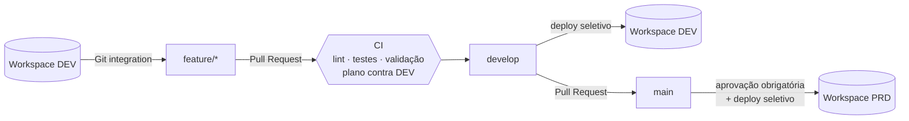
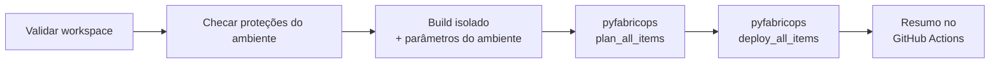

# Fabric Deploy Pipeline

[](https://github.com/jonatasvelloso/fabric-deploy-pipeline/actions/workflows/ci.yml)


Esteira de CI/CD para **qualquer item do Microsoft Fabric**: Lakehouse, Environment, Notebook, Data Pipeline, Semantic Model, Report, Dataflow, Variable Library, Warehouse, Eventhouse e outros. O deploy é feito pelo **[pyfabricops](https://pypi.org/project/pyfabricops/)**. Este projeto adiciona em volta dele o que uma operação real precisa: validação no pull request, parâmetros por ambiente, proteções de produção e um relatório legível de cada execução.

> O workspace de exemplo é **fictício** (área comercial de uma empresa inventada). Nenhum ID, endpoint ou credencial real está no repositório.

---

## Fluxo



Cada execução de deploy segue esta sequência:



## Divisão de responsabilidades

| O pyfabricops faz | Esta esteira acrescenta |
|---|---|
| Cria ou atualiza cada item pela API do Fabric | **Validação sem credenciais** em todo PR: `.platform`, arquivos obrigatórios por tipo, JSON, referências quebradas, dependências circulares, IDs fixos no código |
| Ordem por dependência entre tipos e itens | **Parâmetros por ambiente** (`config/parameters.yml`), com valores sensíveis lidos de secrets |
| Deploy seletivo pelo diff do Git desde um commit | **Build isolado**: os parâmetros são aplicados em uma cópia, nunca nos arquivos versionados |
| Troca `logicalId` → ID do item no destino e GUID zerado → ID do workspace | **Proteções**: deploy completo em produção exige confirmação; exclusão de itens só onde o ambiente permite |
| Converte o relatório de `byPath` para `byConnection` | **Plano antes do deploy** e **resumo em tabela** no GitHub Actions |
| Cria a estrutura de pastas do workspace | **Workflows prontos**: PR, DEV, PRD com aprovação, disparo manual com opções |

## Workspace de exemplo

Exportado no formato da integração do Fabric com Git (uma pasta `<Nome>.<Tipo>` com `.platform` por item):

```
workspace/
├── Engenharia/
│   ├── Comercial.Lakehouse
│   ├── Spark Padrao.Environment
│   ├── funcoes_comuns.Notebook          # usado via %run
│   ├── Ingestao Vendas.Notebook         # API -> bronze
│   ├── Transformacao Vendas.Notebook    # bronze -> silver -> gold
│   └── Carga Diaria Comercial.DataPipeline
└── Analytics/
    ├── Comercial.SemanticModel          # TMDL, Direct Lake
    └── Painel Comercial.Report          # PBIR
```

As dependências são lidas pelo próprio pyfabricops: o notebook depende do Lakehouse, do Environment e do notebook chamado por `%run`; o pipeline depende dos notebooks; o relatório depende do modelo semântico. Com isso, o Lakehouse é criado antes dos notebooks, e o modelo antes do relatório.

## Configuração

**Ambientes** ([`config/environments.yml`](config/environments.yml)):

```yaml
environments:
  dev:
    workspace: $ENV:FABRIC_WORKSPACE   # nome ou ID, vindo de um secret
    protected: false
    allow_deletions: true
  prd:
    workspace: $ENV:FABRIC_WORKSPACE
    protected: true                    # deploy completo exige --force-full
    allow_deletions: false             # exclusão em produção é sempre manual
```

**Parâmetros** ([`config/parameters.yml`](config/parameters.yml)): find/replace com um valor por ambiente, com filtro por tipo de item, nome de item e arquivo. O `find` é sempre o valor de DEV, porque é desse workspace que os arquivos são exportados.

```yaml
find_replace:
  - description: Endpoint SQL do Lakehouse no modelo Direct Lake
    find: comercial-dev.datawarehouse.fabric.example.com
    replace:
      dev: comercial-dev.datawarehouse.fabric.example.com
      prd: $ENV:FABRIC_SQL_ENDPOINT      # vem de um secret do Environment PRD
    item_types: [SemanticModel]
    file_pattern: expressions\.tmdl$
```

A validação do PR falha se alguma regra não define valor para todos os ambientes, e avisa quando encontra um GUID fixo que não está parametrizado.

## Proteções

| Situação | Comportamento |
|---|---|
| `--mode full` em ambiente `protected` | Recusado, a menos que venha com `--force-full` |
| `--allow-deletions` em ambiente com `allow_deletions: false` | Recusado |
| Exclusões no modo completo | Nunca: só itens removidos no diff seletivo são excluídos |
| Validação com erro | Para antes de autenticar no Fabric |
| Secret de parâmetro ausente | Para antes de enviar qualquer item |
| Dois deploys no mesmo ambiente | O segundo espera (`concurrency` do GitHub Actions) |
| Push em `main` | Só começa depois da aprovação do Environment `PRD` |

## Como usar

**Configuração no GitHub:**

1. Crie um service principal no Microsoft Entra ID, habilite *Service principals can use Fabric APIs* no portal de administração e dê a ele acesso de Admin ou Member aos workspaces.
2. Em **Settings → Environments**, crie `DEV` e `PRD`. Em `PRD`, ative **Required reviewers**.
3. Em cada Environment, cadastre os secrets:

| Secret | Uso |
|---|---|
| `FAB_TENANT_ID`, `FAB_CLIENT_ID`, `FAB_CLIENT_SECRET` | Autenticação do pyfabricops (service principal) |
| `FABRIC_WORKSPACE` | Nome ou ID do workspace daquele ambiente |
| `FABRIC_SQL_ENDPOINT` | Exemplo de parâmetro sensível (só em PRD) |

4. Em **Settings → Secrets and variables → Actions → Variables**, crie `FABRIC_DEPLOY_ENABLED = true`. Até lá o workflow de deploy fica desligado, para que um clone sem credenciais não tente implantar.

**Linha de comando:**

```bash
pip install -e ".[dev]"

fabric-deploy validate                                   # sem credenciais
fabric-deploy render --env prd --out build/prd           # inspeciona a cópia parametrizada
fabric-deploy plan   --env dev --base-ref origin/develop # dry-run contra o workspace
fabric-deploy deploy --env dev --base-ref HEAD~1         # deploy seletivo
fabric-deploy deploy --env prd --mode full --force-full  # completo em produção, confirmado
fabric-deploy deploy --env dev --item-types Notebook,DataPipeline
```

**Disparo manual** (Actions → Deploy Fabric → Run workflow): permite escolher o modo, restringir tipos de item, permitir exclusões e confirmar deploy completo.

## Testes

`pytest` cobre, sem acessar o Fabric:

- **Validação**: cada tipo de erro estrutural, referência quebrada, ciclo de `%run`, ID fixo, regra sem valor para algum ambiente e tipo de item desconhecido (aceito com aviso).
- **Parâmetros**: valores por ambiente, filtros, regex, secret ausente, `.platform` intocado.
- **Orquestração**: com um dublê do pyfabricops, verifica deploy seletivo, build isolado, proteções e filtro de tipos.
- **Contrato com o pyfabricops real**: todos os tipos do workspace estão no `DEPLOY_ORDER` da biblioteca, ela empacota cada item e lê as dependências esperadas.

O deploy contra um workspace real depende de um tenant Fabric com service principal configurado, como descrito acima.

## Estrutura

```
├── workspace/                 # itens do Fabric (formato Git do Fabric)
├── config/
│   ├── environments.yml       # destinos, proteção, exclusão
│   └── parameters.yml         # valores por ambiente
├── src/fabric_deploy/
│   ├── cli.py                 # validate · render · plan · deploy
│   ├── deploy.py              # proteções, build isolado, chamada ao pyfabricops
│   ├── validate.py            # checagens do PR (usa o leitor de dependências do pyfabricops)
│   ├── parameters.py          # find/replace por ambiente com secrets
│   ├── item_types.py          # arquivos obrigatórios por tipo de item
│   ├── items.py               # leitura dos .platform
│   └── summary.py             # tabelas para o terminal e o GitHub Actions
├── tests/
└── .github/workflows/
    ├── ci.yml                 # PR: lint, testes, validação, plano contra DEV
    └── deploy.yml             # develop -> DEV, main -> PRD (com aprovação)
```

## Autor

**Jonatas Veloso**, Engenheiro de Dados · [LinkedIn](https://www.linkedin.com/in/jonatasveloso)

Licença MIT.
